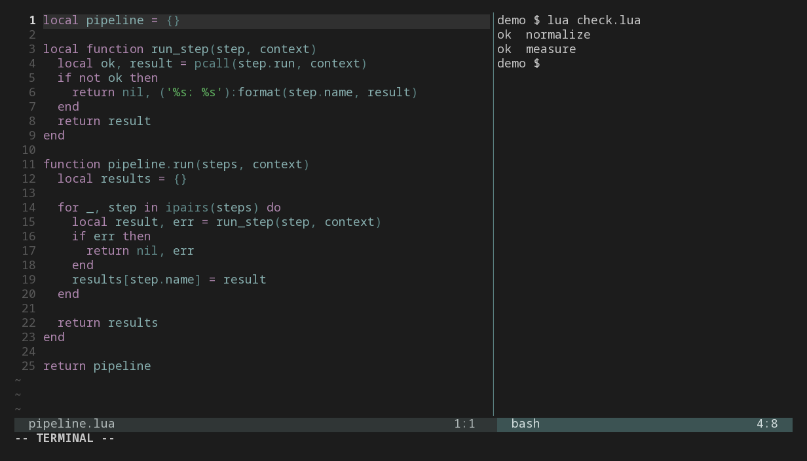
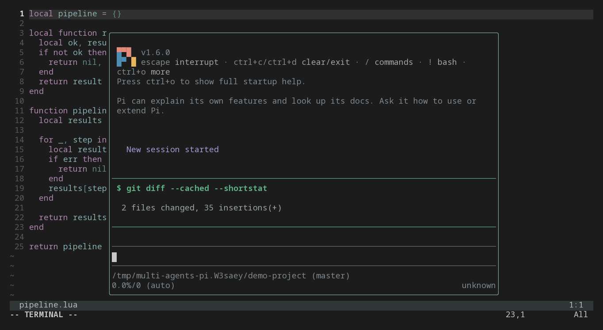
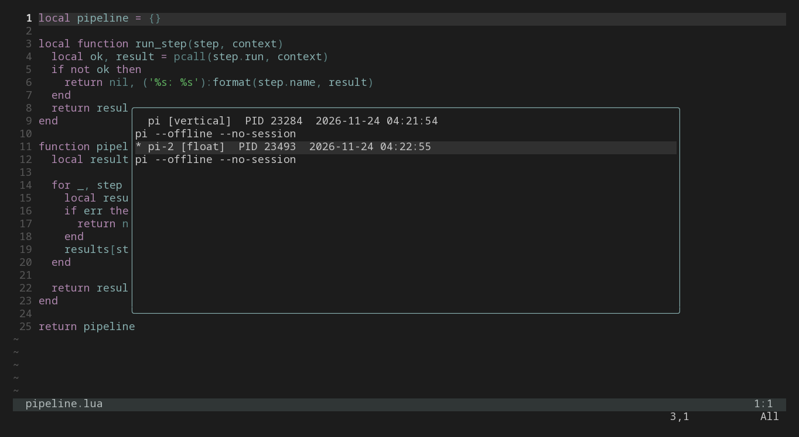

# multi-agents.nvim

Run multiple terminal agents in Neovim and switch between them without stopping their jobs.
Launch any agent CLI or shell command in a floating window, vertical split, or horizontal split.

Version: v0.4.2

## Screenshots

Pi running project checks beside a Lua file in a vertical split.



<details>
<summary>Floating terminal and agent list</summary>

`:OpenFloat` opens a terminal over the current editor window.



`:ListAgent` shows running sessions and marks the selected agent with an asterisk.



</details>

## Installation

Requires Neovim 0.9.5 or later. Install any agent CLI you want to run and make it available in your shell.
With lazy.nvim, add the following spec. For manual setup, use `require("multi-agents").setup(opts)`.

```lua
{
  'suemi994/multi-agents.nvim',
  branch = 'nvim-0.9.5',
  main = 'multi-agents',
  opts = {
    command = vim.o.shell, -- Set this to your preferred agent command
    env = { EXAMPLE_ENV = 'some value' },
    window = {
      mode = 'vertical',
      vertical = { side = 'right', split_ratio = 0.3 },
      horizontal = { side = 'bottom', split_ratio = 0.5 },
      float = {
        width = '80%', height = '80%',
        row = 'center', col = 'center',
        relative = 'editor', border = 'rounded',
      },
    },
    git = { use_git_root = true },
  },
}
```

When omitted, `opts.command` defaults to Neovim's `shell` option. Agent processes inherit
the terminal environment with `opts.env` applied on top. Set `git.use_git_root = false`
to start from Neovim's current working directory. Float dimensions and positions accept
absolute values or percentages. Set `window.mode` to `'horizontal'` to open agents
in a horizontal split by default. `window.horizontal.side` accepts `'top'` or
`'bottom'`. Its `split_ratio` is a fraction of the available editor height in
`(0, 1]`. Each agent keeps its current layout when reopened.
Agent terminals are unlisted and floating agent windows use the editor's Normal background.

## Commands

| Command | Behavior |
| --- | --- |
| `:OpenAgent [--mode float\|vertical\|horizontal] [command]` | Create a new terminal, defaulting to `opts.command`. The buffer is named after the first recognized agent executable in the command, or the first command word if there is no match. Duplicates get suffixes such as `-2`. |
| `:OpenFloat [command]` | Open an agent in a float. Uses `opts.command` when no command is supplied. |
| `:OpenVertical [command]` | Open an agent in a vertical split. Uses `opts.command` when no command is supplied. |
| `:OpenHorizontal [command]` | Open an agent in a horizontal split. Uses `opts.command` when no command is supplied. |
| `:ListAgent` | List one live agent per row in a float. Each row starts with `[buffer name]` and the full command, followed by the layout, PID, and local launch time. The current default is marked with `*`. Use ↑/↓ to move, Enter to select, Esc to cancel, and `zh`/`zl` to scroll long rows horizontally. |
| `:SelectAgent {buffer name, agent name, or PID}` | Set the default agent for commands such as `:ToggleAgent`. Matches the buffer name first, then the agent name, then the process ID. When matching an agent name, selects its earliest live session. |
| `:ToggleAgent [name or buffer number]` | Show or hide the specified or selected terminal. A name or number makes that terminal the default. With no live agents, the argument-free form creates one. |
| `:ReshapeAgent [name or buffer number] [mode] [--layout width,height]` | Change an existing terminal to `float`, `vertical`, or `horizontal` while keeping its buffer and job. Omit the name to use the selected agent, or omit the mode to cycle through `float` → `vertical` → `horizontal` → `float`. Hidden agents apply the new layout when shown. |
| `:CloseAgent [name or buffer number]` | Stop the job and remove the specified or selected buffer. Closing the selected agent selects the next live agent in creation order, wrapping to the first. |

For example, `:OpenAgent --mode float sh -i` starts an interactive shell in a floating window.
The plugin forwards arguments after the executable to the command. Use a leading `--`
to end plugin option parsing explicitly. When an agent exits, its buffer is removed automatically.

Use `:ReshapeAgent`, `:ReshapeAgent codex`, or `:ReshapeAgent codex vertical`.
A single mode argument also works for the selected agent unless an agent has that name.
Use `:ReshapeAgent codex float --layout 80,20` to set the width and height in
editor cells. Percentages such as `75%,60%` also work. A vertical split uses
only the width, and a horizontal split uses only the height. For example,
`:ReshapeAgent horizontal --layout 100%,12` sets the selected agent to 12 rows.
Omitting `--layout` restores the configured default size.

With Neovim mouse support enabled, drag a float border or a split separator
to resize an agent. Each agent remembers its own size when hidden
and shown again. Resizing a split also redistributes space among adjacent panes.

Setup binds `<C-,>` to `:ToggleAgent` in normal and terminal mode by default.
Set `keymaps.toggle.normal` or `keymaps.toggle.terminal` to a different key, or
to `false` to disable the binding in that mode.

```lua
require('multi-agents').setup({
  keymaps = { toggle = { normal = '<leader>aa', terminal = false } },
})
```

## License

[MIT](LICENSE)
